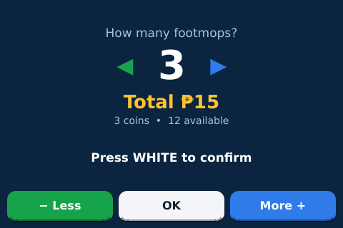
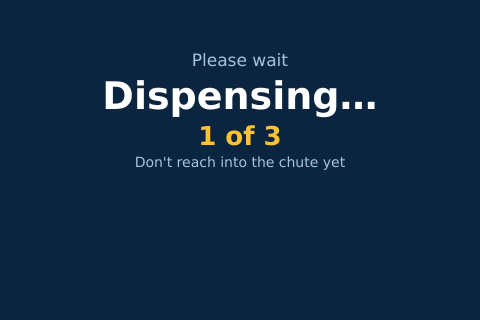
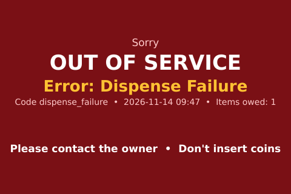
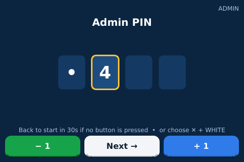
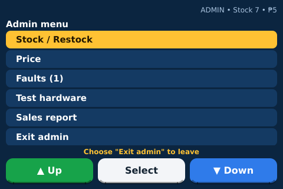
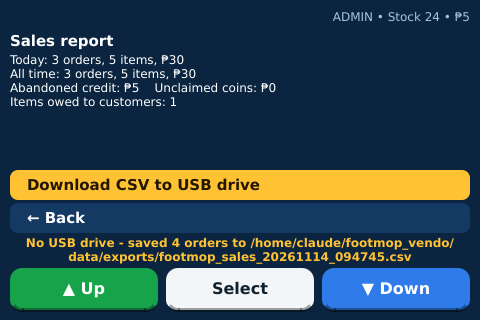

# EmbedniJuswa

Embedded projects by **JushouaS**.

| Project | What it is |
|---|---|
| [**Footmop ni Kuya J**](footmop_vendo/) | A Raspberry Pi 5 footmop vending machine with a 3.5" screen, three physical buttons, a ₱5 coin slot and a drop sensor |

---

# Footmop ni Kuya J – Footmop Vending Machine

A full-screen vending kiosk written in Python (PyQt5) for a **Raspberry Pi 5**
with a **3.5" SPI screen**. It has no touchscreen: customers use three
physical buttons (**GREEN / WHITE / BLUE**). It sells footmops at **₱5 each**,
takes ₱5 coins, and dispenses one footmop at a time. An **MG995 continuous
servo** spins the dispenser, and an **IR sensor** stops it the moment a
footmop drops.

<table>
<tr>
<td><br><sub>Welcome</sub></td>
<td><br><sub>Choose quantity</sub></td>
<td><br><sub>Insert coins</sub></td>
</tr>
<tr>
<td><br><sub>Dispensing</sub></td>
<td><br><sub>Done</sub></td>
<td><br><sub>Jam → locked until the owner checks it</sub></td>
</tr>
<tr>
<td><br><sub>Admin PIN (buttons only)</sub></td>
<td><br><sub>Admin menu</sub></td>
<td><br><sub>Sales report → CSV to USB</sub></td>
</tr>
</table>

## Features

- **Buttons only, short presses only.** GREEN = less / up, BLUE = more / down,
  WHITE = OK. Nothing needs a long press or holding two buttons at once.
- **Simple purchase flow:** Welcome → choose quantity (up to the stock
  available) → pay with ₱5 coins → dispense → "Salamat po!".
- **Coins are counted only on the payment screen.** Exact amount only; no
  change is given.
- **Coin noise filtering.** Pulse width, gap and stuck-line checks stop
  electrical noise from counting as coins.
- **Servo + IR sensor dispensing.** The MG995 servo spins until the IR
  sensor sees the footmop drop, then stops immediately. If nothing drops
  within 5 s (a jam), the servo stops, the machine locks on **OUT OF
  SERVICE**, and it records how many items the customer is still owed.
- **"Still there?" timeout.** After 60 s with no button press, a 15 s
  countdown starts, then the order is cancelled.
- **Survives power cuts.** Stock, every coin and every sale are saved to
  SQLite immediately. Unfinished orders are recovered at boot.
- **Admin mode:**
  - **Opening it:** press a secret button sequence, then enter the PIN.
  - **What you can do:** restock, change the price, clear faults, test the
    hardware, and see the sales report.
  - **Exporting sales:** download the sales report as a **CSV to a USB flash
    drive**.
- **Self-healing.** The app starts automatically at boot. A systemd watchdog
  restarts it if it freezes. Several separate safety checks force the servo
  to stop.
- **PC simulator.** Try every screen on Windows, Mac or Linux with the
  keyboard. No Pi needed.

---

## Hardware

| Part | Notes |
|---|---|
| Raspberry Pi 5 + official 27 W power supply | Raspberry Pi OS **Bookworm 64-bit (Lite)** |
| 3.5" SPI screen (480×320, ILI9486, Waveshare-compatible) | Plugs onto pins 1–26. Touch is not used |
| 3 push buttons: GREEN, WHITE, BLUE | Each wired between a GPIO pin and GND |
| ₱5 single-coin acceptor (12 V) + **PC817 optocoupler** | Never connect the 12 V coin signal straight to the Pi |
| IR sensor module (TCRT5000) | Stops the servo when a footmop drops. Power it from **3.3 V**, not 5 V |
| **MG995 continuous-rotation (360°) servo** + its own **5–6 V, 2–3 A** supply | Never power the servo from the Pi. Join the grounds |
| 40-pin GPIO splitter / extension | Needed to reach pins 13, 15 and 16 under the screen |
| *(Recommended)* a relay on the coin acceptor's 12 V | Physically rejects coins when not on the payment screen |

### Wiring (BCM GPIO numbers)

| Function | GPIO | Physical pin |
|---|---|---|
| GREEN button | GPIO 17 | 11 * |
| BLUE button | GPIO 27 | 13 * |
| WHITE button | GPIO 22 | 15 * |
| Coin pulse signal (through the PC817) | GPIO 23 | 16 * |
| IR sensor `DO` | GPIO 26 | 37 |
| MG995 servo signal (orange) | GPIO 12 | 32 |
| Coin-slot relay *(optional)* | GPIO 21 | 40 |
| GND | – | 30, 34, 39 |

\* Under the 3.5" screen, so you need a GPIO splitter/extension to reach
them. **Don't use GPIO 7–11, 24 or 25**: the screen uses them (GPIO 25 is
its reset line). GPIO 17 is the screen's unused touch-interrupt line. If
the kiosk says GPIO 17 is busy, see "Green button on GPIO 17" in
[`WIRING.md`](footmop_vendo/docs/WIRING.md).

Full diagrams and tips: [`footmop_vendo/docs/WIRING.md`](footmop_vendo/docs/WIRING.md).

---

## How to run it on the Raspberry Pi 5

### Step 1 – Prepare the SD card

1. On your computer, install **Raspberry Pi Imager** from
   <https://www.raspberrypi.com/software/>.
2. Choose these:
   - **Device:** Raspberry Pi 5
   - **OS:** *Raspberry Pi OS (other)* → **Raspberry Pi OS Lite (64-bit)**
   - **Storage:** your microSD card
3. Click **Edit settings** and set:
   - **Username:** for example `pi`, with a password.
   - **Wi-Fi:** your network name and password.
   - **Services:** turn on **Enable SSH**.
4. Write the card, put it in the Pi, and power it on. The first boot takes
   about 2 minutes.

### Step 2 – Connect to the Pi

From your computer's terminal (PowerShell on Windows), run:

```bash
ssh pi@raspberrypi.local
```

If `raspberrypi.local` doesn't work, use the Pi's IP address from your
router's device list, for example `ssh pi@192.168.1.50`.

**Every command below runs on the Pi**, inside this SSH window.

### Step 3 – Update the Pi and install Git

```bash
sudo apt update && sudo apt full-upgrade -y
sudo apt install -y git
```

### Step 4 – Set up the 3.5" screen

Install the driver from your screen's seller for **Pi 5 / Bookworm**. For a
Waveshare-compatible 3.5" (A) board, that means enabling SPI and loading
their overlay in `/boot/firmware/config.txt`:

```
dtparam=spi=on
dtoverlay=waveshare35a
```

Follow the seller's page for your exact model, since clones differ. Reboot
and check that text appears on the small screen. More details:
[`footmop_vendo/docs/DISPLAY_SETUP.md`](footmop_vendo/docs/DISPLAY_SETUP.md).

### Step 5 – Download this project

```bash
cd ~
git clone https://github.com/JushouaS/EmbedniJuswa.git
cd EmbedniJuswa/footmop_vendo
```

### Step 6 – Install the kiosk

```bash
sudo ./deploy/install.sh
```

The installer does the following:

- installs PyQt5 and lgpio;
- copies the app to `/opt/footmop`;
- creates the settings file `/etc/footmop/config.toml`;
- sets up automatic mounting of USB flash drives;
- makes the kiosk **start automatically at every boot**.

### Step 7 – One-time settings

1. **Check the settings:** admin PIN (default `0412`), GPIO pins and price.

   ```bash
   sudo nano /etc/footmop/config.toml
   ```

   Save with **Ctrl+O**, then **Enter**, then exit with **Ctrl+X**.

2. **(Optional) keep the servo still during boot.** Open the boot config:

   ```bash
   sudo nano /boot/firmware/config.txt
   ```

   Add this line at the very bottom:

   ```
   gpio=12=op,dl
   ```

3. Reboot:

   ```bash
   sudo reboot
   ```

### Step 8 – First start and hardware check

After the reboot, the kiosk opens full-screen by itself. The first time, it
shows **SOLD OUT**, because the stock is 0.

1. **Open admin.** Quickly press **GREEN, BLUE, GREEN, BLUE, GREEN**, then
   enter the PIN **0412**:
   - GREEN/BLUE change the digit.
   - WHITE goes to the next digit.
   - WHITE on the last digit enters the PIN.
2. **Test hardware:**
   - Press each button: its level changes on screen.
   - Insert a ₱5 coin: you should see `COIN +P5`.
   - Hold a footmop in front of the IR sensor: it should show `BLOCKED`.
   - Select **Test dispense 1 item**: the servo spins, one footmop drops,
     and the servo stops as soon as the IR sensor sees it. If it spins the
     wrong way, set `servo_spin_us = 1000` in `config.toml`.
3. **Stock / Restock:** set the real number of footmops, digit by digit.
   WHITE on the last digit saves.
4. **Exit admin.** The welcome screen appears and the machine is ready to
   sell.

### Step 9 – If coins aren't counted correctly

Measure your coin acceptor's pulses and adjust the settings:

```bash
sudo systemctl stop footmop
python3 /opt/footmop/tools/coin_probe.py --gpio 23
```

Insert a few coins and note the `width=` values the probe prints. Then:

1. Run `sudo nano /etc/footmop/config.toml`.
2. Under `[coin]`, set `pulse_min_ms` a little **below** the smallest width
   and `pulse_max_ms` a little **above** the largest.
3. Start the kiosk again:

   ```bash
   sudo systemctl start footmop
   ```

### Updating to a newer version later

```bash
cd ~/EmbedniJuswa && git pull
cd footmop_vendo && sudo ./deploy/install.sh
sudo systemctl restart footmop
```

Your settings, stock and sales history are kept. They live in
`/etc/footmop` and `/var/lib/footmop`, which updates don't overwrite.

---

## Using the machine

**Customer**

| Screen | GREEN (left) | WHITE (middle) | BLUE (right) |
|---|---|---|---|
| Welcome | – | Buy | – |
| Quantity | Less (at 1: **Cancel**) | OK | More |
| Payment | Back | – | – |
| Done | – | Done | – |

**Owner (admin)**

| Task | How |
|---|---|
| Open admin | Quickly press G B G B G → PIN **0412** |
| Restock | Admin → **Stock / Restock** → set digits → WHITE on the last digit saves |
| Change price | Admin → **Price** (must be a multiple of ₱5) |
| Machine says OUT OF SERVICE | Fix the jam or blocked chute → Admin → **Faults** → **Clear all faults**. Give the customer the "items owed" by hand |
| Sales as a spreadsheet | Plug a USB flash drive into the Pi → Admin → **Sales report** → **Download CSV to USB drive** → unplug when it says "safe to remove" |
| Leave admin | **Exit admin**. The PIN screen also goes back to the start screen by itself after 30 s with no press |

**Useful commands (over SSH)**

```bash
sudo systemctl status footmop     # is it running?
sudo systemctl restart footmop    # restart the kiosk
sudo systemctl stop footmop       # stop it for maintenance
journalctl -u footmop -f          # live log (Ctrl+C to quit)
```

---

## Try it on your PC first (simulator)

No Pi needed. Python 3.11 or newer is required.

```bash
pip install PyQt5
git clone https://github.com/JushouaS/EmbedniJuswa.git
cd EmbedniJuswa/footmop_vendo
python -m footmop --mock --windowed --seed-stock 10
```

On Windows, use `py` instead of `python`.

| Key | Does |
|---|---|
| ← or ↑ | GREEN button |
| → or ↓ | BLUE button |
| Enter | WHITE button |
| C | Insert a ₱5 coin |
| J | Simulate a dispenser jam |
| ← → ← → ← | Open admin (PIN 0412) |
| Esc | Quit |

Run the tests with `pip install pytest`, then `python -m pytest -q`.

---

## Troubleshooting

| Problem | What to check |
|---|---|
| Small screen stays black | Is the screen driver installed (Step 4)? Run `journalctl -u footmop -f` for errors. Try `FOOTMOP_FB=/dev/fb1` in `/etc/footmop/footmop.env` |
| "Hardware initialisation failed" | Run `sudo apt install python3-lgpio`. Check that no pin in `config.toml` clashes with the screen (GPIO 7–11, 17, 24, 25) |
| Buttons do nothing | Admin → Test hardware: does the level change? Each button must go between its GPIO and **GND** |
| Coins not counted | Do Step 9. Check the PC817 wiring and set the coin acceptor's NO/NC switch to **NO** |
| Every sale says "Dispense Failure" | The IR sensor never sees the footmop, so the servo times out after 5 s. Move the sensor closer (2–15 mm), turn its potentiometer, and power it from 3.3 V |
| Servo spins the wrong way | Set `servo_spin_us = 1000` in `/etc/footmop/config.toml`, then `sudo systemctl restart footmop` |
| Servo creeps when stopped | Turn the MG995's centre trimmer (if it has one). Check that the servo supply GND is joined to the Pi GND |
| Pi reboots when the servo starts | The servo is powered from the Pi. Give it its own 5–6 V, 2–3 A supply |
| Forgot the admin PIN | Over SSH: `sudo nano /etc/footmop/config.toml`, change `pin`, then `sudo systemctl restart footmop` |
| CSV says "No USB drive" | Use a FAT32 or exFAT flash drive, and re-run `sudo ./deploy/install.sh` once to set up USB auto-mount |

---

## More documentation

- [`footmop_vendo/docs/HOW_TO_RUN.md`](footmop_vendo/docs/HOW_TO_RUN.md): detailed step-by-step guide (PC and Pi)
- [`footmop_vendo/docs/WIRING.md`](footmop_vendo/docs/WIRING.md): wiring, coin acceptor, IR sensor and MG995 servo
- [`footmop_vendo/docs/DISPLAY_SETUP.md`](footmop_vendo/docs/DISPLAY_SETUP.md): 3.5" screen setup
- [`footmop_vendo/README.md`](footmop_vendo/README.md): technical overview, policies and project layout
